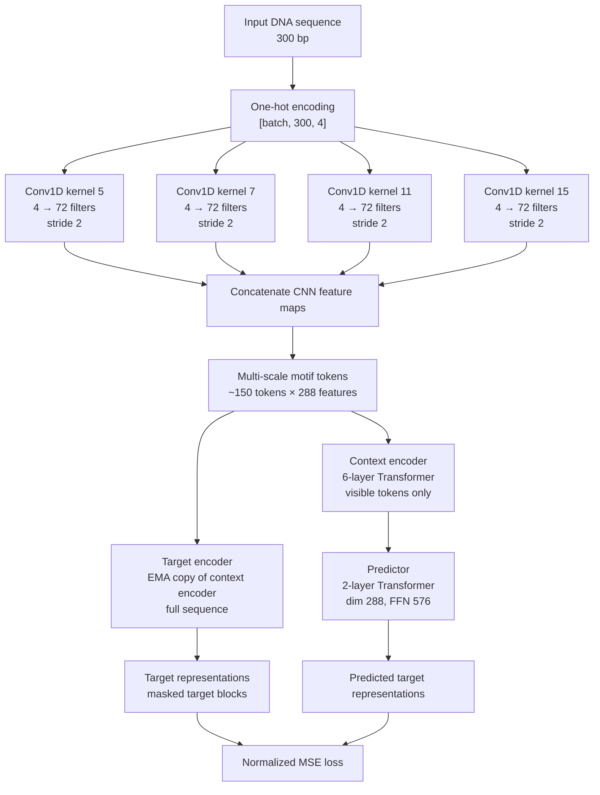

# JEPA pretraining for viral sequence classification

A CNN-Transformer encoder is pretrained without labels on 300 bp DNA windows, using a Joint-Embedding Predictive Architecture (JEPA) adapted from JEPA-DNA ([arXiv 2602.17162](https://arxiv.org/abs/2602.17162)). It is then fine-tuned for viral vs non-viral classification on ViraMiner.

## Idea

JEPA does not reconstruct the masked DNA. It predicts the **representation** that a slowly-updated copy of the encoder assigns to the full, unmasked sequence. The model has to learn what a sequence *is* from partial evidence, rather than memorising base-level detail.

```
            full sequence ──► target encoder (EMA, no grad) ──► mean-pool ──► z  (target)
                                                                               │
  masked sequence ──► context encoder ──► tokens ──► predictor ──► ẑ ──── 1 − cos(ẑ, z)
                                            │
                                            └──► MLM head ──► masked bases (cross-entropy)
```

## Architecture




## Components

| Part | Definition |
|---|---|
| Input | 300 bp one-hot (A, C, G, T); N is all-zero |
| Encoder | multi-kernel CNN stem (kernels 5/7/11/15, 72 filters each, stride 2) → 150 tokens × 288 dims → 6-layer pre-norm Transformer (8 heads), learned positions, final LayerNorm. 6.05M params |
| Target encoder | copy of the encoder, updated only by EMA: `θ_t ← m·θ_t + (1−m)·θ`, with `m` rising linearly 0.996 → 1.0 |
| Predictor | Linear 288→144 → masked tokens replaced by a learnable mask token → fixed sinusoidal positions → 4 pre-norm Transformer layers (144 dims, 3 heads) → mean-pool → Linear 144→288. 1.09M params |
| MLM head | Linear 288→8: predicts the 2 bases under each masked token |
| Sequence representation | mean of the encoder's output tokens |

## Masking

- Spans are drawn on the 150 tokens. Each token covers 2 bp.
- The schedule grows linearly over training:
  - start: 1–2 spans covering 10–30% of the tokens;
  - end: 1–4 spans covering 30–50%.
- Masked bases are set to N **before** the CNN stem. Convolutions therefore cannot leak masked bases into neighbouring tokens.
- The target encoder always sees the full sequence.

## Loss

```
L = 1.0 · L_jepa + 0.1 · L_mlm + 25 · L_var + 0.5 · L_cov
```

| Term | What it does |
|---|---|
| `L_jepa = 1 − cos(ẑ, z)` | Sequence-level prediction: the predicted representation of the masked sequence should match the target encoder's representation of the full one. |
| `L_mlm` | Cross-entropy on the masked bases. Keeps the tokens informative at the base level. |
| `L_var = mean_d max(0, 1 − std_d)` | VICReg variance: every dimension must vary across the batch. Prevents collapse to a constant. |
| `L_cov = Σ_{i≠j} cov_ij² / d` | VICReg covariance: decorrelates dimensions. Prevents collapse to a few directions. |

`L_var` and `L_cov` are computed on a separate clean (unmasked) pass through the encoder and predictor, in eval mode.

## Training

| | Pretraining | Fine-tuning |
|---|---|---|
| Data | corpus_v3: 4M unlabeled windows from viruses, phages, human and gut bacteria. Anelloviruses excluded; windows overlapping ViraMiner val/test removed | ViraMiner (about 2% viral) |
| Steps / epochs | 60k steps × batch 512 (about 7.7 passes) | up to 120 epochs, early stop after 15 epochs without improvement, batch 128 |
| Optimiser | AdamW, lr 5e-4, betas (0.9, 0.95), wd 0.05, 3k warmup, cosine decay | AdamW, lr 1e-4 (stem and head) / 5e-5 (Transformer), wd 1e-4, 5 warmup epochs, cosine |
| Augmentation | reverse complement (p = 0.5), random ±5 bp shift | same |
| Precision | bf16 | bf16 |

The classifier starts from the **EMA target encoder**. It adds a learned CLS token, one attention layer and an MLP (288→512→128→1). It is trained with focal loss (α = 0.75, γ = 2), and model selection uses validation AP.

**Differences from JEPA-DNA.** JEPA-DNA continues training already-pretrained models. Here the encoder is trained from scratch, which leads to three changes:
- AdamW at a higher learning rate replaces SGD at about 5e-6;
- there is no initial frozen-encoder phase;
- the reverse-complement and shift augmentations are added.

## Monitoring

- **Every 200 steps:** each loss term, MLM accuracy, mask ratio, representation std and throughput.
- **Every 5k steps:** a frozen linear probe (logistic regression on mean-pooled features, both strands averaged), trained on 50k ViraMiner train windows and scored by **AP** on validation; plus RankMe (effective rank of the features, max 288).
- **End of pretraining:** the same probe on the full train set, scored on test, against a randomly initialised encoder. Pretraining has learned something useful only if the JEPA probe AP is clearly above the random one.

## Evaluation

| Task | Fine-tune on | Validate on | Test on |
|---|---|---|---|
| `fullset` | `fullset_train` | `fullset_validation` | `fullset_test` (551 viral / 26,405) |
| `anell` (unseen family) | `training_data_anell`, minus exact test duplicates | 10% stratified split of it | `test_data_anell` (1,348 viral / 27,644) |

- Anelloviruses are absent from both pretraining and fine-tuning in the `anell` task.
- That task needs its own fine-tune, because its test positives also appear in `fullset_train`.
- Each task is run with JEPA and random initialisation, 3 seeds each.
- Reported metrics: AUROC, **AP**, precision, recall, F1 and specificity, at the best-F1 threshold chosen on validation. Each is given plain and with reverse-complement test-time averaging (RC-TTA), with bootstrap 95% CIs for AUROC and AP.

## Files

| File | Role |
|---|---|
| `model.py` | encoder, predictor, classifier, GPU data pipeline |
| `pretrain.py` | JEPA pretraining and probes → `pretrain/` (`history.csv`, `probe_history.csv`, `probe_test.json`, `pretrain_curves.png`, `encoder.pt`) |
| `finetune.py` | `--task fullset\|anell --init jepa\|random --seed N` → `finetune/<task>_<init>_s<seed>/result.json` |
| `report.py` | `report.md` and `report.png`: all metrics, mean ± std over seeds |
| `recipe.slurm` | runs pretraining → 12 fine-tunes → report on one GPU; it can be resubmitted and resumes |

```bash
python pretrain.py --corpus-dir CORPUS --data-path DATA --save-dir RUN
python finetune.py --task fullset --init jepa --encoder RUN/pretrain/encoder.pt --data-path DATA --save-dir RUN
python report.py --save-dir RUN
```

## Results

Pending.
