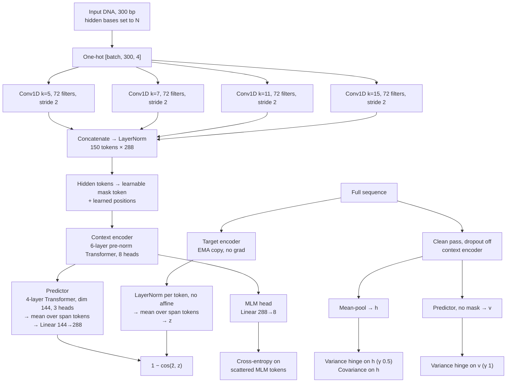

# JEPA pretraining for viral sequence classification

A CNN-Transformer encoder is pretrained without labels on 300 bp DNA windows, using a Joint-Embedding Predictive Architecture (JEPA) adapted from JEPA-DNA ([arXiv 2602.17162](https://arxiv.org/abs/2602.17162)). It is then fine-tuned for viral vs non-viral classification on ViraMiner.

The pretraining corpus (corpus_v3) is built in a separate repository: [Luckycrucio/CorpusViralJEPA](https://github.com/Luckycrucio/CorpusViralJEPA).

## Idea

JEPA does not reconstruct the masked DNA. It predicts the **representation** that a slowly-updated copy of the encoder, seeing the full unmasked sequence, assigns to the hidden spans. The model has to learn what the missing region *is* from its context, rather than memorising base-level detail.

```
  window A (full) ──► target encoder (EMA) ──► mean of last 3 blocks, LayerNorm'd ──► span token targets
                                                                                          │ MSE
  window A (masked) ──► context encoder ──► tokens ──► predictor ──► predicted span tokens ┘
                              │               └──► MLM head ──► bases of the scattered MLM tokens
                              └──► CLS ──► projector ──► predictor ──► 1 − cos(·, target projector(target CLS of B))
                                    │         └──► VICReg variance + covariance
                                    └──► k-mer head ──► KL to the 4-mer profile of B
  window B = another window of the same record (genome / contig / chromosome), augmented independently
```

## exp04: what changed and why

exp03's probe fell from 0.80 to 0.58 AUROC. Its variance hinge sat on the mean of the encoder's tokens, which can only vary across the batch if the tokens of a sequence point the same way: they collapsed (token similarity 0.97), and the covariance penalty spread the per-sequence vectors into a near-isotropic, input-sensitive code (RankMe 285/288, jepa_constant 0.89). Context and target also saw the same window, so nothing rewarded invariance to anything meaningful. exp04:

- puts a **CLS token inside the encoder** (as in Viraminer3); the classifier reads it directly;
- gives the CLS its own objectives on a **second view**, another window of the same record: BYOL-style prediction of the EMA target's projected CLS, VICReg on the **projector output** (not on the representation), and the second window's **4-mer profile** (`--kmer-weight 0` turns it off). Only record membership is used, never the category;
- leaves the tokens free to differ: token JEPA predicts **every masked span token** against **data2vec targets** (mean of the last `--target-blocks` blocks, each LayerNorm'd), with MSE; no variance term on pooled tokens;
- probes both the CLS output and the mean-pooled tokens.

Ablations: `--views window` (second view = the same window re-augmented), `--kmer-weight 0`, `--target-blocks 1`.

The sections below still describe exp03 where they differ from this list.

## Architecture




## Components

| Part | Definition |
|---|---|
| Input | 300 bp one-hot (A, C, G, T); N is all-zero |
| Encoder | multi-kernel CNN stem (kernels 5/7/11/15, 72 filters each, stride 2, LayerNorm) → 150 tokens × 288 dims → masked tokens replaced by a learnable mask token → 6-layer pre-norm Transformer (8 heads), learned positions, final LayerNorm. 6.05M params |
| Target encoder | copy of the encoder, updated only by EMA: `θ_t ← m·θ_t + (1−m)·θ`, with `m` rising linearly 0.996 → 1.0 |
| Predictor | Linear 288→144 → masked tokens replaced by a learnable mask token → fixed sinusoidal positions → 4 pre-norm Transformer layers (144 dims, 3 heads) → mean over the JEPA span positions → Linear 144→288. 1.09M params |
| MLM head | Linear 288→8: predicts the 2 bases under each MLM token |
| Sequence representation | mean of the encoder's output tokens |

## Masking

Two kinds of tokens are hidden from the context encoder. Each token covers 2 bp.

- **JEPA spans:** contiguous spans that never overlap, so the coverage is exact. The schedule grows linearly over training:
  - start: 1–2 spans covering 10–20% of the tokens;
  - end: 1–4 spans covering 20–30%.
- **MLM tokens:** single tokens outside the spans, each hidden with probability 0.15 (`--mlm-rate`), about 11–13% of all tokens. Their neighbours stay visible, so their bases can be predicted from local context. The MLM loss is scored only on these tokens.
- In total about 28% of tokens are hidden at the start and 36% at the end. This matches the ratio exp02 actually reached: its schedule aimed for 20% → 40%, but overlapping spans gave 19% → 36%.
- The bases of hidden tokens are set to N **before** the CNN stem, so no visible token's convolution sees them. The hidden tokens are then replaced by a learnable mask token **after** the stem.
- The target encoder always sees the full sequence.

**exp02 → exp03.** In exp02, MLM was scored inside the long JEPA spans (30–150 bp). The bases in the middle of a span have no nearby context, so the loss never beat base frequencies (about 1.38). exp02's encoder also had no mask token: hidden tokens entered the Transformer as the stem's output on N bases.

## Loss

```
L = 1.0 · L_jepa + 1.0 · L_mlm + 25 · (L_var(h; γ=0.5) + L_var(v; γ=1)) + 0.5 · L_cov(h)
```

The weights are JEPA-DNA's, taken from its released code (`jepa_losses.py`, `jepa_pretrainer.py`). Three things differ from it: the variance target on `h`, the covariance normalisation, and the target pooling (see below).

| Term | What it does |
|---|---|
| `L_jepa = 1 − cos(ẑ, z)` | Span-level prediction. The target encoder sees the full sequence; its tokens get a LayerNorm without affine parameters, and `z` is their mean over the JEPA span positions (`--target-pool span`; `all` pools the whole sequence, as JEPA-DNA does). `ẑ` is the predictor's mean over the same positions, from the masked context. |
| `L_mlm` | Cross-entropy on the bases of the scattered MLM tokens. Keeps the tokens informative at the base level. |
| `L_var = mean_d max(0, γ − std_d)` | VICReg variance hinge: every dimension must vary across the batch. Prevents collapse to a constant. γ = 0.5 for `h` (`--var-gamma`), 1 for `v`. |
| `L_cov = Σ_{i≠j} cov_ij² / d` | VICReg covariance: decorrelates dimensions. Prevents collapse to a few directions. |

The VICReg terms use a separate clean (unmasked) pass with dropout off:
- `h` is the encoder's mean-pooled output. This is the representation that is probed and fine-tuned.
- `v` is the predictor's output on those clean tokens. The JEPA-DNA paper notes that without a variance term here, "the predictor drives the context encoder toward a low-rank solution".

**exp02 → exp03.** What changed here, and why:
- exp02 applied variance and covariance to `v` only. The predictor's final LayerNorm rescales any input to unit scale, so the penalty was satisfied while the encoder collapsed: the probe fell from 0.80 to 0.56 AUROC and RankMe to about 20. exp02's covariance on `v` was also 86% of its final loss.
- The variance target on `h` is γ = 0.5, not 1. The encoder's tokens leave a LayerNorm with squared norm `d`, so the pooled `h` has total variance at most `d`. Std 1 in every dimension is reachable only if all tokens of a sequence are identical. In a local test with γ = 1, the encoder did exactly that within 500 steps: token cosine 0.998, RankMe 48 → 3.7, probe AUROC 0.79 → 0.70.
- The covariance is divided by `d`, as in VICReg. JEPA-DNA's `d(d−1)` is 287× weaker, and in the same test it did not stop the features collapsing onto a few directions. With γ = 0.5 and ÷ `d`, RankMe was 194 at step 500 and token similarity was falling (0.86 → 0.80).
- The JEPA target is pooled over the masked spans only (as in I-JEPA). Pooled over the whole sequence, most of the target comes from tokens the context encoder sees, and the loss fell to 0.025 in exp02.
- exp02 used an MLM weight of 0.1, and its target had no LayerNorm.

## Training

| | Pretraining | Fine-tuning |
|---|---|---|
| Data | corpus_v3: 4M unlabeled windows from viruses, phages, human and gut bacteria. Anelloviruses excluded; windows overlapping ViraMiner val/test removed | ViraMiner (about 2% viral) |
| Steps / epochs | 60k steps × batch 512 (about 7.7 passes) | up to 120 epochs, early stop after 15 epochs without improvement, batch 128 |
| Optimiser | AdamW, lr 5e-4 → 1e-6, betas (0.9, 0.95), wd 0.05 (not on biases, norms, positions, mask token), 3k warmup, cosine decay | AdamW, lr 1e-4 for the stem and the new head (CLS attention + MLP), 5e-5 for the encoder's Transformer, wd 1e-4, 5 warmup epochs, cosine. In exp02 the CLS attention layer was in the 5e-5 group |
| Augmentation | reverse complement (p = 0.5), random ±5 bp shift | same |
| Precision | bf16 | bf16 |

The classifier starts from the **EMA target encoder**. It adds a learned CLS token, one attention layer and an MLP (288→512→128→1). It is trained with focal loss (α = 0.75, γ = 2), and model selection uses validation AP.

**Differences from JEPA-DNA, and why.** The loss weights, the target LayerNorm, the predictor design and the EMA schedule follow the JEPA-DNA code. The variance target on `h`, the covariance normalisation and the target pooling differ (see Loss). The rest differs because of the setting.

JEPA-DNA continues training already-pretrained models on long sequences: 512 BPE tokens (~2.5 kb) for DNABERT-2, 8,192 tokens for NTv3. Here a small encoder is trained from scratch on 300 bp windows (150 tokens).

| | JEPA-DNA | here | why |
|---|---|---|---|
| Optimiser | SGD, momentum 0.9, lr ~5e-6, wd 0.01 on all parameters, no gradient clipping | AdamW 5e-4, wd 0.05 (not on biases, norms, positions, mask token), clip 1.0 | Their tiny lr only nudges an already-trained model; from scratch it would barely move |
| Frozen-encoder phase | 1k steps training only the predictor | none | Freezing a random encoder teaches the predictor nothing useful |
| Mask ratio | 10–30% → 30–50% of tokens, spans may overlap | spans 10–20% → 20–30%, no overlaps, plus ~12% scattered MLM tokens; ~28% → 36% hidden in total | On 150 tokens a 50% span is up to 150 bp, a large share of a 300 bp window |
| MLM positions | inside the JEPA spans | scattered single tokens | Their tokens are multi-base BPE words on a pretrained model. A from-scratch single-nucleotide model cannot predict the middle of a 30–150 bp span: in exp02 the loss stayed at the base-frequency level (about 1.38) |
| Predictor | DNABERT-2 / HyenaDNA: 4-layer Transformer at half width. NTv3 (mean-pooled): a 3-layer MLP on the pooled embedding | 4-layer Transformer at half width, 3 heads, mean over the span positions | Attention over 150 tokens is cheap, and it lets the predictor know which positions are masked. The NTv3 MLP was likely chosen because of the 8k-token length |
| Augmentation | none | reverse complement, ±5 bp shift | Same as exp01 fine-tuning |

## Monitoring

- **Every 200 steps:** each loss term (`variance` for `h`, `predictor_variance` for `v`), `jepa_constant` (`const` in the log: the JEPA loss of predicting the batch-mean target for every sequence; `jepa` carries sequence-specific information only when clearly below it. With a random-init encoder it is about 0.02, the level exp02's final loss of 0.025 sat at), MLM accuracy, mask ratio (all hidden tokens: spans + MLM), representation std (of the encoder's pooled output `h`), token similarity (`tsim`: cosine of each clean token to its sequence's mean; near 1 means the tokens have collapsed onto one vector) and throughput.
- **Every 5k steps:** a frozen linear probe (logistic regression on mean-pooled features, both strands averaged), trained on 50k ViraMiner train windows and scored by **AP** on validation; plus RankMe (effective rank of the features, max 288).
- **End of pretraining:** the same probe on the full train set, scored on test, against a randomly initialised encoder. Pretraining has learned something useful only if the JEPA probe AP is clearly above the random one.

## Evaluation

| Task | Fine-tune on | Validate on | Test on |
|---|---|---|---|
| `fullset` | `fullset_train` | `fullset_validation` | `fullset_test` (551 viral / 26,405) |
| `anell` (unseen family) | `training_data_anell`, minus exact test duplicates | 10% stratified split of it | `test_data_anell` (1,348 viral / 27,644) |

- Anelloviruses are absent from both pretraining and fine-tuning in the `anell` task.
- That task needs its own fine-tune, because its test positives also appear in `fullset_train`.
- Each task is run with JEPA and random initialisation, 3 seeds each.
- Reported metrics: AUROC, **AP**, precision, recall, F1 and specificity, at the best-F1 threshold chosen on validation. Each is given plain and with reverse-complement test-time averaging (RC-TTA), with bootstrap 95% CIs for AUROC and AP.

## Files

| File | Role |
|---|---|
| `model.py` | encoder, predictor, classifier, GPU data pipeline |
| `pretrain.py` | JEPA pretraining and probes → `pretrain/` (`history.csv`, `probe_history.csv`, `probe_test.json`, `pretrain_curves.png`, `encoder.pt`) |
| `finetune.py` | `--task fullset\|anell --init jepa\|random --seed N` → `finetune/<task>_<init>_s<seed>/result.json` |
| `report.py` | `report.md` and `report.png`: all metrics, mean ± std over seeds |
| `recipe.slurm` | runs pretraining → 12 fine-tunes → report on one GPU into `/save/runs/exp04` (24 h, 4 CPUs, 32 GB); it can be resubmitted and resumes |

```bash
python pretrain.py --corpus-dir CORPUS --data-path DATA --save-dir RUN
python finetune.py --task fullset --init jepa --encoder RUN/pretrain/encoder.pt --data-path DATA --save-dir RUN
python report.py --save-dir RUN
```

## Results

Pending.

## Running exp03

Paths are the ones the exp02 job used on the cluster (`/save/corpus_v3`, `/data`, `/save/runs/...`); change them if yours differ.

### 1. Smoke test (about 10–15 min)

Use a separate save dir: `pretrain.py` resumes from any checkpoint it finds, and skips entirely if `encoder.pt` exists.

```bash
SMOKE=/save/runs/exp03_smoke
python pretrain.py --corpus-dir /save/corpus_v3 --data-path /data --save-dir $SMOKE \
    --max-windows 20000 --steps 400 --warmup-steps 50 --log-every 50 --eval-every 200 --probe-train-size 5000
python finetune.py --task fullset --init jepa --encoder $SMOKE/pretrain/encoder.pt \
    --data-path /data --save-dir $SMOKE --epochs 2 --patience 2
python report.py --save-dir $SMOKE
```

The first run in a new save dir parses the corpus CSVs into `corpus_codes.npy`, which takes longer than the 16 s cached load. The final probe on the full train set also adds a few minutes.

Check:
- no errors, and `encoder.pt`, `result.json` and `report.md` are written;
- `representation_std` (`std` in the log) stays at or above about 0.5, and `tsim` stays well below 1 (0.80 at step 500 in the local test);
- the step-200 probe AUROC is not clearly below the step-0 one.

Delete `$SMOKE` afterwards.

### 2. Full run

```bash
RUN=/save/runs/exp03
python pretrain.py --corpus-dir /save/corpus_v3 --data-path /data --save-dir $RUN
for task in fullset anell; do
  for seed in 0 1 2; do
    python finetune.py --task $task --init jepa --encoder $RUN/pretrain/encoder.pt --data-path /data --save-dir $RUN --seed $seed
    python finetune.py --task $task --init random --data-path /data --save-dir $RUN --seed $seed
  done
done
python report.py --save-dir $RUN
```

Or submit `sbatch recipe.slurm`, which runs the same steps. Every step skips work that is already done, so the job can be resubmitted.

Pretraining takes about 3 h, and each of the 12 fine-tunes about 1 h. Rerun the random-init fine-tunes too: the stem now uses LayerNorm, so the exp02 random baselines are a different model.

exp04: use `RUN=/save/runs/exp04` (the first run parses the corpus again, to add the record groups) and also watch:
- `tsim` stays well below exp03's 0.97;
- `global` falls below `global_constant`, and `kmer` below `kmer_constant`;
- the CLS probe (`probe_auroc`) and the mean-pool probe (`mean_probe_auroc`) stay at or above step 0;
- `distinct_views` in `history.csv` is the fraction of steps whose second view is a different window (about 0.95 expected on corpus_v3; only the ViraMiner rows are single-window).

What to watch in `pretrain/probe_history.csv`:
- probe AUROC stays at or above the step-0 value; in exp02 it had fallen to 0.71 by 5k;
- RankMe stays well above 20 (194 at step 500 in the local test), and `tsim` in `history.csv` does not climb toward 1;
- `jepa` falls clearly below `jepa_constant` (both about 0.28 at step 500 in the local test, so the predictor had not yet learned anything sequence-specific); a sudden drop of both toward 0.02 means the targets have lost their per-sequence content again;
- MLM loss falls clearly below about 1.38, which is what predicting base frequencies alone scores (exp02 never got under 1.358); `mask_ratio` runs from about 0.28 to 0.36.

If the probe is still falling by 10k steps, stop the job; the fine-tunes would not be worth running.
