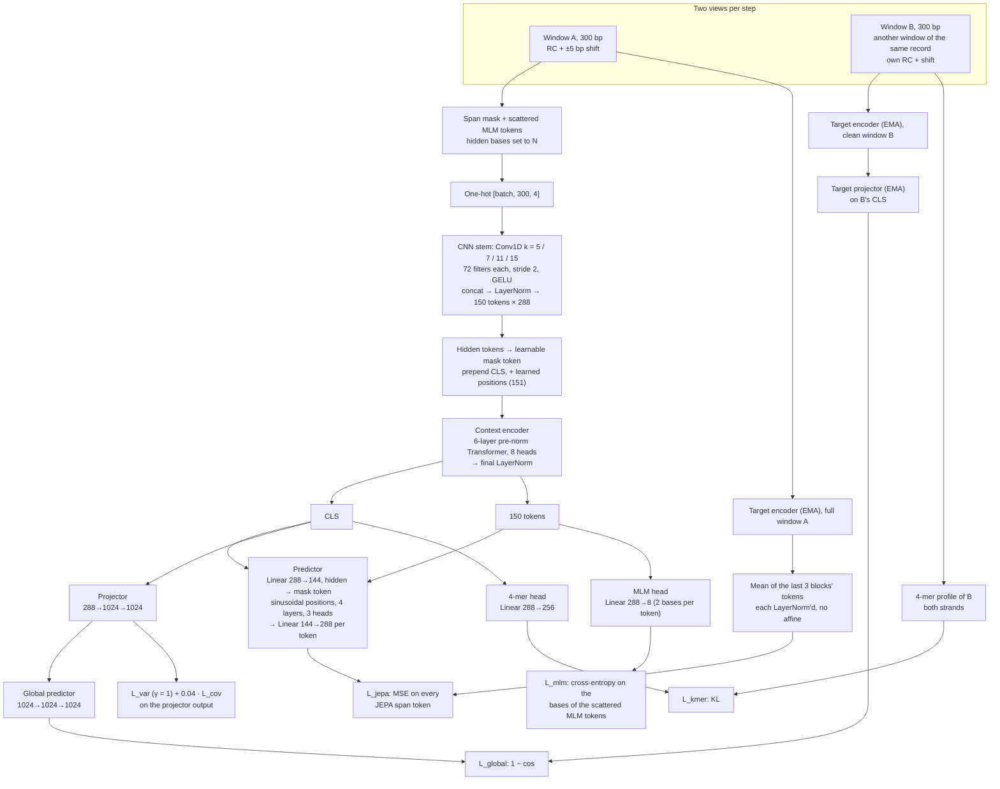

# JEPA pretraining with Self-Genome Supervision for viral sequence classification

A CNN-Transformer encoder is pretrained without labels on 300 bp DNA windows, using a Joint-Embedding Predictive Architecture (JEPA) using a self-genome supervision on the CLS token. It is then fine-tuned for viral vs non-viral classification on ViraMiner.

The pretraining corpus (corpus_v3) is built in a separate repository: [Luckycrucio/CorpusViralJEPA](https://github.com/Luckycrucio/CorpusViralJEPA).

The code in this repository is the **exp05**-**exp04** version. exp02 and exp03 are kept only as results (`exp02/`, `exp03/`); see [Experiments](#experiments) for what each one changed.

## Idea

JEPA does not reconstruct the masked DNA. It predicts the **representation** that a slowly updated (EMA) copy of the encoder assigns to the hidden regions, while that copy sees the full, unmasked sequence. To do this, the model has to infer what the missing region *is* from its context, instead of memorising base-level detail.

exp04 trains two levels of representation at the same time:

- **Tokens** (one per 2 bp): each hidden token must be predicted from the visible ones (token JEPA), and a few scattered single tokens must also be decoded back to their bases (MLM).
- **The CLS token** (the sequence summary the classifier reads): from a masked window A, it must predict the EMA encoder's CLS embedding of **another window B of the same genome, contig or chromosome**, and B's 4-mer profile. No category or label is ever used, only which windows come from the same record.

## Architecture



The EMA copy covers both the encoder and the projector. The predictor, global predictor, MLM head and 4-mer head have no EMA copy and are discarded after pretraining. Fine-tuning starts from the EMA target encoder.

## Components

| Part | Definition | Params |
|---|---|---|
| Input | 300 bp one-hot (A, C, G, T); N is all-zero | |
| Encoder | multi-kernel CNN stem (kernels 5/7/11/15, 72 filters each, stride 2, GELU, LayerNorm, dropout 0.25) → 150 tokens × 288 → hidden tokens replaced by a learnable mask token → CLS token prepended → learned positions → 6-layer pre-norm Transformer (8 heads, FFN 1152, dropout 0.1) → final LayerNorm. Outputs the CLS and the 150 tokens | 6.05M |
| Target encoder + target projector | copies of the encoder and projector, updated only by EMA: `θ_t ← m·θ_t + (1−m)·θ`, with `m` rising linearly from 0.996 to 1.0 | |
| Token predictor | Linear 288→144 on [CLS, tokens] → hidden tokens replaced by a learnable mask token → fixed sinusoidal positions → 4 pre-norm Transformer layers (144 dims, 3 heads) → LayerNorm → Linear 144→288 for **every token** | 1.09M |
| Projector | MLP 288→1024→1024 (Linear–LayerNorm–GELU–Linear) on the CLS | 3.45M (with the global predictor) |
| Global predictor | MLP 1024→1024→1024, same form | |
| 4-mer head | Linear 288→256 on the CLS | |
| MLM head | Linear 288→8 on each token: the 2 bases it covers | |
| Classifier | the encoder's CLS output → MLP 288→512→128→1 (GELU, dropout 0.25, LayerNorm after the first layer) | 6.27M in total |

The projector and global predictor use LayerNorm instead of BYOL's BatchNorm, and so does the stem: BatchNorm keeps running statistics, and these would drift between the masked online batches and the clean EMA passes.

## Masking

Two kinds of tokens are hidden from the context encoder. Each token covers 2 bp. Masking is applied to window A only.

- **JEPA spans:** contiguous spans that never overlap, so the coverage is exact. The schedule grows linearly over training:
  - start: 1–2 spans covering 10–20% of the tokens;
  - end: 1–4 spans covering 20–30%.
- **MLM tokens:** single tokens outside the spans, each hidden with probability 0.15 (`--mlm-rate`), about 11–13% of all tokens. Their neighbours stay visible, so their bases can be predicted from local context.
- In total about 28% of the tokens are hidden at the start and 36% at the end.
- The bases of hidden tokens are set to N **before** the CNN stem, so that no visible token's convolution sees them. The hidden tokens are then replaced by the mask token **after** the stem. The CLS token is never masked.
- The token predictor sees both kinds of hidden token as mask tokens, but the JEPA loss is scored only on the span tokens, and the MLM loss only on the scattered tokens.
- The target encoder always sees full, unmasked windows.

## Loss

```
L = L_jepa + L_global + L_kmer + L_mlm + L_var(z; γ=1) + 0.04 · L_cov(z)
```

| Term | What it does |
|---|---|
| `L_jepa` | Token JEPA (I-JEPA style). The predictor outputs one vector per token. The loss is the MSE against a data2vec target: the mean of the target encoder's last 3 Transformer block outputs on the full window A (`--target-blocks`), each LayerNorm'd without affine parameters. Scored on every JEPA span token. |
| `L_global` | BYOL-style CLS objective. With `z = projector(CLS of masked A)`, the loss is `1 − cos(global_predictor(z), target_projector(target CLS of clean B))`. It rewards what windows of the same organism share (composition, codon usage), which is the signal viral detection rests on. DNABERT-S uses the same kind of same-genome positives. |
| `L_kmer` | KL divergence between `softmax(kmer_head(CLS of masked A))` and B's 4-mer frequencies over both strands (k-mers containing N are skipped). This is a label-free composition target, and it covers what a random encoder already captures. `--kmer-weight 0` turns it off. |
| `L_mlm` | Cross-entropy on the bases of the scattered MLM tokens (N bases are ignored). Keeps the tokens informative at base level. |
| `L_var = mean_d max(0, γ − std_d)` | VICReg variance hinge on `z`, the **projector output**: every dimension must vary across the batch. This prevents collapse to a constant. |
| `L_cov = Σ_{i≠j} cov_ij² / d` | VICReg covariance on `z`: decorrelates the dimensions. This prevents collapse onto a few directions. |

As in VICReg, the variance and covariance terms act on the expander (the projector) and not on the representation itself. The encoder's tokens are therefore free to differ from each other; exp03's terms on the pooled tokens made them collapse (see [exp03](#exp03-variance-on-the-encoder)).

## Training

| | Pretraining | Fine-tuning |
|---|---|---|
| Data | corpus_v3: 4M unlabelled windows from viruses, phages, human and gut bacteria, in 341,501 records (192,400 of them single-window). Anelloviruses are excluded, and windows overlapping the ViraMiner validation/test sets are removed | ViraMiner (about 2% viral) |
| Views | A, plus B = another window of the same record (`--views record`). A single-window record uses itself, so about 95% of steps have a distinct B. `--views window` uses A again with a new augmentation | one view |
| Steps / epochs | 60k steps × batch 512 (about 7.7 passes) | up to 120 epochs, early stop after 15 epochs without improvement, batch 128 |
| Optimiser | AdamW, lr 5e-4 → 1e-6, betas (0.9, 0.95), wd 0.05 (not on biases, norms, positions, mask and CLS tokens), 3k warmup steps, cosine decay, gradient clip 1.0 | AdamW: lr 1e-4 for the stem, CLS token, positions and the MLP head, 5e-5 for the encoder's Transformer; wd 1e-4; 5 warmup epochs, cosine decay, gradient clip 1.0. The Transformer is **frozen for the first 5 epochs** (`--freeze-epochs`), so the head fits before the features move |
| Augmentation | reverse complement (p = 0.5), random ±5 bp shift with N padding, drawn independently for A and B | same |
| Precision | bf16 (Ampere or newer) | bf16 |

The classifier starts from the **EMA target encoder** and reads its CLS output directly. It is trained with focal loss (α = 0.75, γ = 2, label smoothing 0.05). Model selection uses validation AP with reverse-complement averaging.

## Monitoring

- **Every 200 steps** (`history.csv` and the log): every loss term next to its **batch-mean baseline**, which is the loss of predicting the batch mean for every sequence (`jepa_constant`, `global_constant`, `kmer_constant`). A term carries sequence-specific information only when it is clearly below its baseline. Also logged: MLM accuracy, `cls_std` (std of the context CLS across the batch), `token_similarity` (`tsim`: cosine of each target token to its sequence's mean; near 1 means the tokens have collapsed onto one vector), `mask_ratio`, `distinct_views` (fraction of steps whose B is a different window) and throughput.
- **Every 5k steps** (`probe_history.csv`): a frozen linear probe (logistic regression, features averaged over both strands) on the target encoder. It is trained on 50k `fullset_train` windows and scored by AUROC and **AP** on `fullset_validation`, both on the **CLS** output and on the **mean-pooled tokens** (`mean_` columns). RankMe (effective rank of the features, max 288) is logged for both.
- **End of pretraining** (`probe_test.json`): the same probes, trained on the full `fullset_train` and scored on `fullset_test`, against a randomly initialised encoder. Pretraining has learned something useful only if the JEPA probe AP is clearly above the random one.

## Evaluation

| Task | Fine-tune on | Validate on | Test on |
|---|---|---|---|
| `fullset` | `fullset_train` | `fullset_validation` | `fullset_test` (551 viral / 26,405) |
| `anell` (unseen family) | `training_data_anell`, minus exact test duplicates | 10% stratified split of it | `test_data_anell` (1,348 viral / 27,644) |

- In the `anell` task, anelloviruses are absent from both pretraining and fine-tuning.
- That task needs its own fine-tune, because its test positives also appear in `fullset_train`.
- Each task is run with JEPA and random initialisation, 3 seeds each (12 fine-tunes).
- Reported metrics: AUROC, **AP**, precision, recall, F1 and specificity, at the best-F1 threshold chosen on validation. Each is given plain and with reverse-complement test-time averaging (RC-TTA), with bootstrap 95% CIs for AUROC and AP.

## Experiments

All three runs use the same corpus, the same CNN-Transformer encoder, 60k pretraining steps and the same 12 fine-tunes. They differ in the pretraining objective. The table shows the frozen linear probe on `fullset_test` (trained on the full `fullset_train`) and the fine-tuned test AP with RC-TTA (mean ± std over 3 seeds).

| | probe AUROC | probe AP | RankMe | fullset AP, JEPA | fullset AP, random | anell AP, JEPA | anell AP, random |
|---|---|---|---|---|---|---|---|
| exp02 | 0.609 (random 0.833) | 0.031 (random 0.111) | 20.6 | 0.200 ± 0.032 | 0.609 ± 0.001 | 0.098 ± 0.002 | 0.255 ± 0.020 |
| exp03 | 0.624 (random 0.839) | 0.035 (random 0.130) | 285.2 | 0.592 ± 0.007 | 0.607 ± 0.003 | 0.250 ± 0.039 | 0.271 ± 0.021 |
| **exp04** (CLS) | **0.912** (random 0.840) | **0.375** (random 0.135) | 158.8 | **0.625 ± 0.011** | 0.617 ± 0.005 | **0.491 ± 0.030** | 0.268 ± 0.006 |

For reference, exp01 (a single seed, fine-tuned on `fullset` only) reached an AP of 0.508 with RC-TTA. Full tables are in each `expNN/report.md`.

### exp02: pooled target, variance on the predictor

The token predictor regressed a target pooled over the **whole** sequence, MLM (weight 0.1) was scored inside the long JEPA spans, and VICReg acted only on the predictor's output. Three things went wrong:

- The predictor's final LayerNorm rescales any input to unit scale, so the variance penalty was satisfied while the encoder collapsed (RankMe ~20).
- Most of the pooled target came from tokens the context could already see, so the JEPA loss fell to 0.025, which is the level of a constant prediction.
- The bases in the middle of a 30–150 bp span have no nearby context, so MLM never beat the base frequencies (~1.38).

The probe fell below the random encoder (AP 0.031 vs 0.111), and the JEPA initialisation hurt fine-tuning badly.

### exp03: variance on the encoder

exp03 fixed each of these:

- the target is pooled over the masked spans only;
- MLM is scored on scattered single tokens (weight 1);
- a learnable mask token is used, and the stem uses LayerNorm;
- the VICReg terms moved onto the encoder's mean-pooled output `h` (variance γ = 0.5, covariance ÷ d).

But the mean of 150 LayerNorm'd tokens can only vary across the batch if a sequence's tokens all point the same way, so the tokens collapsed onto one vector per sequence (`tsim` 0.97). The covariance penalty then spread those vectors into a near-isotropic, input-sensitive code: RankMe 285/288, and targets of different sequences were nearly orthogonal (`jepa_constant` 0.89). Context and target also saw the same window, so nothing rewarded invariance to anything meaningful. The test probe ended at 0.62 AUROC, against 0.84 for a random encoder, and fine-tuning from JEPA was no better than from random.

### exp04: CLS with same-record views

exp04 separates the two levels of representation (see [Architecture](#architecture) and [Loss](#loss)):

- **A CLS token inside the encoder** (as in Viraminer3) that the classifier reads directly. In exp03, the classifier added its own CLS attention layer on top.
- **Sequence-level objectives on the CLS, against a second view**, another window of the same record: BYOL-style prediction of the EMA target's projected CLS, B's 4-mer profile, and VICReg on the projector output instead of on the representation.
- **Free tokens.** Token JEPA predicts every masked span token against data2vec targets (mean of the last 3 blocks), with MSE. No variance term acts on the pooled tokens.
- **Probes on both** the CLS output and the mean-pooled tokens.
- **Fine-tuning freezes the Transformer for the first 5 epochs** (LP-FT).

**Pretraining** took 2.1 h on one GPU. At the last step, every loss term was below its batch-mean baseline:

| | jepa | global | kmer | mlm |
|---|---|---|---|---|
| loss | 0.717 | 0.546 | 0.335 | 1.349 (accuracy 0.33) |
| batch-mean baseline | 0.846 | 0.627 | 0.413 | ~1.38 (base frequencies) |

Token similarity fell from 0.86 to 0.56 over training, so the tokens no longer collapse. The validation probe AP on the CLS rose steadily, from 0.109 at step 0 to 0.320 at step 60k, with RankMe going from 57 to 158; it never dropped below its step-0 value.

**Frozen probe on `fullset_test`:**

| encoder | features | AUROC | AP | RankMe |
|---|---|---|---|---|
| random init | CLS | 0.840 | 0.135 | 57.3 |
| random init | mean-pool | 0.843 | 0.125 | 47.8 |
| JEPA (EMA target) | CLS | **0.912** | **0.375** | 158.8 |
| JEPA (EMA target) | mean-pool | 0.885 | 0.290 | 160.6 |

This is the first run whose frozen features clearly beat a random encoder: the CLS probe's AP is 2.8× the random one. The CLS is the better of the two feature sets, which fits the objectives it was given.

**Fine-tuning (test, RC-TTA, mean ± std over 3 seeds):**

| task | init | AUROC | AP | F1 | precision | recall | best epoch |
|---|---|---|---|---|---|---|---|
| fullset | JEPA | **0.942 ± 0.005** | **0.625 ± 0.011** | 0.601 ± 0.010 | 0.740 ± 0.024 | 0.507 ± 0.018 | 33–58 |
| fullset | random | 0.931 ± 0.003 | 0.617 ± 0.005 | 0.594 ± 0.006 | 0.775 ± 0.047 | 0.484 ± 0.023 | 101–111 |
| anell | JEPA | **0.895 ± 0.019** | **0.491 ± 0.030** | 0.380 ± 0.048 | 0.755 ± 0.030 | 0.257 ± 0.047 | 32–75 |
| anell | random | 0.822 ± 0.007 | 0.268 ± 0.006 | 0.182 ± 0.007 | 0.587 ± 0.033 | 0.108 ± 0.006 | 94–113 |

- **Unseen family (`anell`):** JEPA pretraining nearly doubles AP (0.49 vs 0.27) and raises AUROC by 7 points. It also more than doubles recall at a higher precision. This is the setting pretraining is meant to help with: the model has never seen an anellovirus, and same-record composition features transfer to the new family.
- **`fullset`:** JEPA is slightly ahead (AUROC +0.011, AP +0.009), but the AP difference is within the seed spread and the bootstrap CIs overlap. Both clearly beat exp01 (0.508).
- JEPA fine-tunes reach their best validation AP after 32–75 epochs, against 94–113 for random initialisation.

Ablations not yet run: `--views window` (B = A re-augmented, which tests whether same-record views matter), `--kmer-weight 0`, `--target-blocks 1`.

### exp05: exp04 on the BLASTn-decontaminated corpus

exp05 reruns exp04 with the same code, config and seeds, on `corpus_v4`. That is `corpus_v3` plus a BLASTn screen, which drops a window if its alignments to one `fullset_test` contig have identity > 70% and E ≤ 1e-3 (word size 7) and cover ≥ 80% of that contig. The screen removed 167,080 windows. 161,897 of them are human repeats, and only 880 were linked to viral test contigs (see [corpus/README.md](../corpus/README.md#corpus_v4-what-blastn-changed)). The random-init fine-tunes don't depend on the corpus and come out identical to exp04's.

| JEPA, RC (fine-tunes: mean of 3 seeds) | val exp04 | val exp05 | test exp04 | test exp05 |
|---|---|---|---|---|
| probe CLS AUROC | 0.889 | 0.891 | 0.912 | 0.919 |
| probe CLS AP | 0.320 | 0.331 | 0.375 | 0.387 |
| fullset AUROC | 0.936 | 0.936 | 0.942 | 0.939 |
| fullset AP | 0.627 | 0.621 | 0.625 | 0.626 |
| anell AUROC | 0.917 | 0.907 | 0.895 | 0.885 |
| anell AP | 0.506 | 0.506 | 0.491 | 0.508 |

- **Pretraining improved slightly, in the CLS.** The validation probe is ahead of exp04 at 11 of 12 checkpoints in AP (+0.011 on average).
- **Fine-tuning didn't measurably change.** Validation AUROC and AP are within about one seed standard deviation of exp04's. The higher anell test AP (+0.017) isn't confirmed on validation, and the paired bootstrap between the two ensembles includes zero (+0.014 [−0.003, 0.030]).
- **The unseen-family gain holds.** The anell ensemble reaches AP 0.545, against 0.296 for random init.
- **Verdict:** decontamination costs nothing and changes no conclusion, so `corpus_v4` should be the default from now on. Full analysis in the addendum section of `ViralJEPA_report/ViralJEPA_report.tex`.

## Files

| File | Role |
|---|---|
| `model.py` | encoder (with CLS), token predictor, projector MLPs, classifier, data loading and GPU augmentation |
| `pretrain.py` | JEPA pretraining and probes → `pretrain/` (`config.json`, `history.csv`, `probe_history.csv`, `probe_test.json`, `pretrain_curves.png`, `checkpoint.pt`, `encoder.pt`) |
| `finetune.py` | `--task fullset\|anell --init jepa\|random --seed N` → `finetune/<task>_<init>_s<seed>/` (`result.json`, `history.csv`, `best_model.pt`, `test_predictions.csv`) |
| `report.py` | `report.md` and `report.png`: all metrics, mean ± std over seeds |
| `exp02/`, `exp03/`, `exp04/` | configs, probe results, fine-tune results, cluster logs and `report.md` of each run (checkpoints are not tracked) |

`recipe.slurm` (gitignored) runs pretraining, the 12 fine-tunes and the report on one GPU (24 h, 4 CPUs, 32 GB). Every step skips work that is already done, so the job can be resubmitted and resumes.

## Running

Paths are the ones used on the cluster (`/save/corpus_v3`, `/data`, `/save/runs/...`); change them if yours differ.

### 1. Smoke test (about 10–15 min)

Use a separate save dir: `pretrain.py` resumes from any checkpoint it finds, and skips entirely if `encoder.pt` exists.

```bash
SMOKE=/save/runs/exp04_smoke
python pretrain.py --corpus-dir /save/corpus_v3 --data-path /data --save-dir $SMOKE \
    --max-windows 20000 --steps 400 --warmup-steps 50 --log-every 50 --eval-every 200 --probe-train-size 5000
python finetune.py --task fullset --init jepa --encoder $SMOKE/pretrain/encoder.pt \
    --data-path /data --save-dir $SMOKE --epochs 2 --patience 2
python report.py --save-dir $SMOKE
```

The first run in a new save dir parses the corpus CSVs into `corpus_codes.npy` and `corpus_codes_groups.npy` (the record of each window), which takes longer than the ~15 s cached load. The final probe on the full train set also adds a few minutes.

Check that there are no errors, and that `encoder.pt`, `result.json` and `report.md` are written. Delete `$SMOKE` afterwards.

### 2. Full run

```bash
RUN=/save/runs/exp04
python pretrain.py --corpus-dir /save/corpus_v3 --data-path /data --save-dir $RUN
for task in fullset anell; do
  for seed in 0 1 2; do
    python finetune.py --task $task --init jepa --encoder $RUN/pretrain/encoder.pt --data-path /data --save-dir $RUN --seed $seed
    python finetune.py --task $task --init random --data-path /data --save-dir $RUN --seed $seed
  done
done
python report.py --save-dir $RUN
```

Or submit `sbatch recipe.slurm`, which runs the same steps. Pretraining takes about 2 h and each fine-tune up to about 1 h. For an ablation, add its flag to `pretrain.py` and use a new `RUN`.

What to watch:
- `jepa`, `global` and `kmer` fall clearly below their `*_constant` baselines, and `mlm` below ~1.38;
- `tsim` stays well below 1 (exp03: 0.97; exp04 ended at 0.56);
- `distinct_views` is about 0.95 on corpus_v3 with `--views record`;
- in `probe_history.csv`, the CLS probe (`probe_ap`) and the mean-pool probe (`mean_probe_ap`) stay at or above their step-0 values, and RankMe does not fall toward ~20 (exp02) or jump toward 288 (exp03).

If the probe is still falling at 10k steps, stop the job: the fine-tunes would not be worth running.
